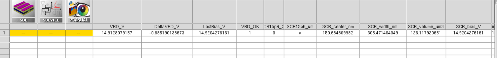

# 3D SPAD electrical baseline — 실행 코드 및 VBD/SCR 결과

- 연구자: 주상현 (`jujushmaterial`)
- 기록일: 2026-11-16 (KST)
- SDevice 실행일: 2026-11-08 17:15:47 ~ 2026-11-09 02:54:50 (KST, 로그 기준)
- SVisualPy 수정·결과 확인: 기존 대화, CSV, DOE 화면을 이번 기록에 정리. 최종 v1.3 화면의 정확한 실행 시각은 확인되지 않아 임의 지정하지 않음.
- 상태: **실행 기준 코드 채택 / 3D 메시 수렴 및 2D 동등성 검증 진행 중**

## 1. 목적과 확정 범위

2D 기준소자에서 사용한 도핑 계열과 전기 물리모델을 유지하여 3D baseline의 전기적 특성을 확보한다. VBD를 15.8 V로 다시 맞추거나 SCR 중심을 180 nm로 재보정하는 작업이 아니다. 현재 결과와 2D 결과의 차이를 재현 가능한 방식으로 기록하고 후속 구조 테스트의 공통 계산 도구를 정한다.

이번 기록에서는 새로운 TCAD 서버 계산을 실행하지 않았다. 사용자가 실행한 결과를 검토하고 기존 코드와 근거를 보존했다. 코드 원본은 수정하지 않고 의미가 분명한 파일명으로 복사했다. [manifest](./baseline-manifest.json)에 기존 파일명, 보관 파일명, SHA-256 및 Git blob SHA를 기록한다.

## 2. 실행 코드와 연결

| 단계 | 기준 파일 | 역할 |
|---|---|---|
| SDE | [Candidate-B v2.6](./CMP_SPAD_3D_CandidateB_v2.6_RadialCoarseBulk_UpperSiZFixed_DualMSH.txt) | 3D 구조·도핑 및 Dual MSH 생성 |
| SDevice | [v1.1 ParDiSo](./CMP_SPAD_3D_v2p6_SDevice_VBD_SCR_v1p1_ParDiSo.txt) | 역바이어스 sweep, ionization integrals, 최종 TDR |
| SVisualPy | [v1.3](./CMP_SPAD_3D_v2p6_SVisualPy_VBD_SCR_DOE_v1p3.txt) | VBD, 마지막 상태 SCR 중심·폭·부피, 진단 데이터와 DOE 출력 |

```text
SDE Candidate-B v2.6
  ├─ n<SDE>_msh.tdr           → SDevice v1.1 → n<SD>_des.plt/.log/.tdr
  │   UpperSi=Oxide                              ↓
  │                                       SVisualPy v1.3 → DOE + 결과 폴더
  └─ n<SDE>_physical_msh.tdr
      UpperSi=Silicon; 현재 전기 baseline 입력이 아님
```

Workbench의 SVisual 노드는 Python 모드로 사용한다. TXT 전체를 해당 도구에 붙여 넣으며 `@node@`, `@node|sde@`, `@node|sdevice@`, `@plot@`, `@tdrdat@`, `@log@`는 Workbench가 치환한다. SDevice의 입력은 `n@node|sde@_msh.tdr`이다. 같은 실행의 `.plt`, `.log`, 마지막 `.tdr`를 함께 사용한다. 다른 실행 결과를 혼합하면 안 된다.

SVisualPy는 실행마다 timestamp/UUID가 포함된 새 출력 폴더를 생성한다. 코드의 LAST 상태 바이어스는 같은 실행의 PLT/log 대조로 판정하며, TDR metadata에서 독립적으로 검증하는 구현은 아니다. 따라서 파일 provenance 관리가 필요하다.

## 3. 고정한 계산 조건

| 항목 | 설정 |
|---|---|
| 실행 환경 | Sentaurus T-2022.03, 사용자 Linux 서버 |
| SDE 도핑 | PW peak 5.95×10¹⁷ cm⁻³, DNW peak 3.15×10¹⁷ cm⁻³; 나머지 원본 정의 유지 |
| 전극 | anode=0 V, substrate=0 V, cathode 양의 역바이어스 sweep |
| substrate 접촉 | 상면 외곽 pickup ring; backside contact가 아님 |
| 온도·통계 | 300 K, Fermi, OldSlotboom |
| 이동도 | DopingDependence, HighFieldSaturation(GradQuasiFermi) |
| 재결합·충돌 이온화 | SRH, Auger, Avalanche(vanOverstraeten GradQuasiFermi) |
| 선형 solver | Method=ParDiSo, 4 threads |
| 수치 기준 | Digits=6, ErrRef(e/h)=1e4, RhsMin=1e-15, Iterations=30 |
| 계산 방식 | Poisson 초기화 후 Poisson/Electron/Hole 결합 계산 |
| sweep 목표 | 0→14→25 V; BreakAtIonIntegral로 조기 종료 가능 |
| avalanche 처리 | AvalPostProcessing; 전류에 self-consistent avalanche feedback을 포함하지 않음 |
| 차원 | 전체 Cartesian 3D. 2D의 Cylindrical 옵션 및 2π/폭 배율을 추가하지 않음 |

25 V는 목표값이며 도달 결과가 아니다. 15.0, 15.4, 15.6 V 등의 snapshot 명령은 해당 전압에 도달했을 때만 결과를 만든다.

## 4. 실행 결과와 근거 수준



위 이미지는 기존 대화에서 제공된 결과 화면이다. 화면의 정확한 촬영·실행 시각은 별도 확인하지 않았다. 오른쪽 일부 열은 잘려 있어 보이지 않는 성공 플래그를 화면에서 확인했다고 기록하지 않는다.

| 지표 | 값 | 근거 및 의미 |
|---|---:|---|
| VBD_V | 14.9128079157 V | 사용자 SVisualPy DOE; 원본 PLT의 전체 배열은 이번 보관에 미포함 |
| DeltaVBD_V | −0.885190138673 V | 3D−2D, 기준 15.7979980544 V; 표시값 반올림에 따른 끝자리 차이 가능 |
| LastBias_V | 14.9204276161 V | DOE; 로그의 마지막 상태와 일치하는 범위 |
| VBD_OK | 1 | 화면에 보이는 추출 성공 플래그; 물리 정확도 인증이 아님 |
| SCR_center_nm | 150.684809982 nm | DOE 및 실제 중심선 CSV 재계산 |
| SCR_width_nm | 305.471404049 nm | DOE 및 실제 중심선 CSV 재계산 |
| SCR_volume_um3 | 126.117920651 µm³ | DOE 화면 관측값; 원본 3D TDR 없이 독립 적분 재현하지 않음 |
| SCR_bias_V | 14.9204276161 V | 마지막 상태 평가 |
| SCR15p6_OK | 0 | 15.6 V 미계산 |
| SCR15p6_um | x | 미계산이며 0 nm가 아님 |

`SCR_line_OK`, `SCR_volume_OK`, `SCR_OK`는 코드가 출력하는 열이다. 이번 화면의 잘린 부분을 근거로 값을 추정하지 않는다. 후속 실행에서는 전체 `metrics.json`과 로그를 보관하여 확인한다.

### 4.1 SDevice 정상 종료

원본 `n2_des.log`에서 다음을 확인했다. [추출한 실행 메타데이터](./evidence/sdevice-run-summary.json)는 로그의 파일 해시 및 줄 번호를 포함한다. 원본 전체 로그와 서버 경로·라이선스 정보는 이 저장소에 복사하지 않았다.

- 시작: 2026-11-08 17:15:47 KST, 종료: 2026-11-09 02:54:50 KST.
- `Finished quasi-stat., because ionization integrals meet specifications.` 후 마지막 `n2_des.tdr` 저장 및 정상 종료 표식.
- 마지막 ionization integrals: electron=1.00103, hole=1.00375.
- wallclock 34,743.01 s = 9 h 39 m 03 s, peak memory 32.23 GB.
- 입력 grid points 373,845. 이 값은 SDevice가 읽은 electrical mesh의 값이며 physical mesh의 통계를 뜻하지 않는다.
- 비선형 재시도 후 회복한 단계가 있으며, 정상 종료가 모든 step의 첫 시도 성공을 뜻하지는 않는다.
- 이번 로그에서 저장된 TDR은 0 V와 마지막 상태이며 15.6 V TDR은 없다.

### 4.2 VBD 정의

각 바이어스 표본에서 `g(V)=min(PhiElectron,PhiHole)`을 만든 뒤 최초 상향 `g=1` 교차를 선형 보간한다. 기존 2D 비교 정의를 유지했다. SDevice 종료 조건 자체와 이 후처리 보간 정의는 동일한 연산이 아니다.

마지막 상태 전압은 VBD보다 약 7.62 mV 높다. SCR을 보간된 VBD의 해에서 계산한 것은 아니다. 반올림된 로그 수치로 VBD를 재계산하면 약 14.9128155 V이며 DOE의 정확한 끝자리를 재현할 수 없다. 이 근사값을 원본 DOE 값 대신 사용하지 않는다.

전자/정공의 개별 교차를 각각 보간한 뒤 먼저/나중 값을 고르는 방식은 sampled-min 보간과 다를 수 있다. 비교 도중 VBD 정의를 바꾸지 않으며, 다른 정의를 추가할 때는 2D와 3D를 모두 같은 방식으로 재처리하고 별도 열로 보관한다.

### 4.3 SCR 중심·폭 정의와 CSV 재계산

- cutline: X=4.6875 µm, Y=0 µm의 수직선.
- 원점: STI 바닥 Z=0. 깊이 `d=-Z`, 아래쪽이 양수. 실리콘 상면 기준 깊이는 `0.300-Z`로 서로 다르다.
- 주 접합: `0≤d≤1.30 µm`에서 첫 `ND−NA=0` 교차.
- 전계 경계: `−0.300≤d≤1.30 µm`에서 주 접합을 감싸는 `|E|=1e5 V/cm`의 가까운 두 교차.
- 중심=`(d_upper+d_lower)/2`, 폭=`d_lower−d_upper`.
- 실측 공핍층이나 3D 체적의 무게중심이 아닌 **전계 임계값 기반 공간 지표**다.

실제 28개 표본 CSV(로컬 보관, 공개 업로드 제외)를 선형 보간한 결과:

| 값 | 결과 |
|---|---:|
| ND−NA=0 접합 깊이 | 164.243730186 nm |
| SCR 상부 경계 | −2.050892043 nm |
| SCR 하부 경계 | 303.420512006 nm |
| SCR 중심 | 150.684809982 nm |
| SCR 폭 | 305.471404049 nm |

음수 상부 경계는 STI 바닥보다 약 2.05 nm 위의 Bulk 실리콘이다. 상면 Z=0.300 µm를 넘지 않는다. 0으로 잘라 대체하면 중심·폭이 달라지므로 실제 교차를 보존했다. 경계 보간 표본 간격은 상부 약 20.18 nm, 하부 약 60.54 nm다. 출력 자릿수는 이보다 높은 물리 정확도를 의미하지 않는다.

### 4.4 SCR 부피 정의

`Bulk`, `r≤12.5 µm`, `−1.30≤Z≤+0.300 µm`에서 고전계·반경 조건의 nodal indicator를 적분한다. STI 바닥 아래와 위를 따로 적분하여 합산하며 STI 산화막은 제외한다. 원통 전체를 고전계 체적으로 간주하지 않는다.

이 값은 메시 보간에 의존하는 3D 고전계 부피 근사다. 주 접합에 연결된 하나의 영역만 추적하는 알고리즘은 아니므로 ROI 안의 분리된 고전계 영역도 포함할 수 있다. 엄밀한 전하중성 기준 공핍층 부피와 구분한다.

v1.2 화면의 124.486886458 µm³는 Z≤0 범위였다. v1.3은 Z>0의 Bulk도 포함하며 최종 화면은 126.117920651 µm³다. 두 버전의 숫자 차이를 물리적 구조 변화로 해석하지 않는다. 현재 보관된 한 개 cutline CSV만으로 이 부피를 재생성할 수 없다.

## 5. 오류 수정 이력

| 순서/버전 | 문제 | 조치 | 확인 범위 |
|---|---|---|---|
| SDevice v1.0 | ILS 사용 중 약 0.2025 V에서 반복 실패 및 종료 | solver 진단 및 0.3 V 별도 진단 코드 준비 | 실패 로그 분석; 모든 원인이 메시라고 단정하지 않음 |
| 0.3 V 진단 | 저전압 수렴 경로 확인 필요 | ParDiSo로 진단 | 사용자가 성공 보고 |
| SDevice v1.1 | 기존 sweep을 정상 수행할 필요 | ParDiSo, PrintLinearSolver, CNormPrint; 도핑·물리모델·정밀도 기준 유지 | 11/8~11/9 서버 로그 정상 종료 |
| SVisualPy v1.0 | 성공한 SDevice 결과의 VBD 및 마지막 상태 확인 | VBD 추출·실행 상태 확인 코드 | 후속 DOE 확장의 기반 |
| SVisualPy v1.1 | SCR DOE 요구 추가, native integrate_field dataset 참조 오류 및 cutline 범위 검증 오류 | 원인 분리 | VBD만 유효, SCR=x였던 로그 |
| SVisualPy v1.2 | API plot 참조 및 반환 좌표 처리 | 실제 plot 전달, 전역 좌표 검증·crop 처리 | 부피 숫자는 출력, 중심/폭 x 지속 |
| SVisualPy v1.3 | d≥0 검색이 상부 경계 −2.05 nm를 버림 | 경계 검색 d≥−0.300으로 확장; 부피도 상면까지 포함 | 실제 CSV 중심/폭 재계산 및 사용자 DOE 숫자 확인 |

SDevice 실행 시각 외의 개별 수정 날짜는 이번 기록에서 추정하지 않는다. 39개 로컬 검사 통과 이력이 있으며 부피/API 검사는 mocks를 사용했다. 로컬 검사 통과와 Sentaurus 서버 실행 성공을 구분한다. [과거 로컬 검사 기록](./evidence/local-validation-history.txt)은 모의 출력 수치를 제외한 검사 결과 요약이다.

## 6. 2D와의 비교 및 미완료 검증

| 항목 | 2D 최종 보고서 | 현재 3D | 3D−2D |
|---|---:|---:|---:|
| VBD | 15.7979980544 V | 14.9128079157 V | 약 −0.88519 V |
| SCR 평가 전압 | 15.6 V | 14.9204276161 V | 약 −0.67957 V |
| SCR 중심 | 180.202945597 nm | 150.684809982 nm | 약 −29.5181 nm |
| SCR 폭 | 341.365736988 nm | 305.471404049 nm | 약 −35.8943 nm |

SCR은 서로 다른 전압에서의 관측 차이다. 이 차이를 바로 수치 오차율 또는 순수 3D 효과로 확정하지 않는다. 2D도 Cylindrical 축대칭 모델이므로 단순히 3D에서만 곡률이 생겼다는 설명은 맞지 않는다.

현재 3D SDE의 전용 `RW.SCR.Active`는 Z=−0.13~+0.30 µm이다. 실제 접합 Z≈−0.16424 µm 및 SCR 하단 Z≈−0.30342 µm는 이 창 밖이다. 다른 doping/bulk mesh 창은 존재하지만, 실제 SCR 전체를 포함한 국부 mesh convergence가 필요하다. 2D와 3D의 MeshScale 숫자는 서로 다른 메시 정의의 배율로 단순 정확도 비율이 아니다.

GitHub에는 [최종 계열 2D SDE v1.3](../spad-baseline-static-freeze/SDE_reference_baseline_v1.3_redarea_uniform_meshconv.txt)가 있으며 `@PW_Dose@`, `@DNW_Dose@`, `@MeshScale@`를 사용한다. 로컬의 더 오래된 `PW_Npeak=5e17` 파일을 최종 실행본으로 혼동하면 안 된다. 최종 DOE가 PW=5.95e17, DNW=3.15e17, MeshScale=0.40이었는지는 실제 전처리 실행본/TDR까지 연결해 확인해야 한다.

다음 순서로 진행한다.

1. 최종 2D 코드·DOE 설정·TDR의 연결을 확인한다.
2. 2D를 14.9204276161 V에서 저장하고 같은 cutline/전계 임계값/좌표로 비교한다. 공통 pre-breakdown 비교는 두 소자 모두 더 낮은 공통 전압을 별도로 선택할 수 있다.
3. 도핑·형상·물리모델을 고정하고 3D 접합/SCR 주변 메시를 단계적으로 세분화한다.
4. 같은 바이어스에서 지표 변화가 안정되는지 확인하고 남는 구조 차이를 기록한다.

## 7. 해석상 제한

- AvalPostProcessing의 역전류는 실제 avalanche 증폭 전류, Geiger pulse, DCR 또는 PDE가 아니다.
- VBD/SCR 숫자 출력은 mesh convergence, PEB 억제 또는 전기적 동등성의 자동 PASS 판정이 아니다.
- 최종 SVisualPy 전체 서버 로그/metrics.json 및 원본 TDR/PLT는 이번 업로드에 없다. 부피는 사용자 화면 근거로 기록한다.
- 후속 구조에서 마지막 종료 전압이 달라지면 각 구조의 SCR은 서로 다른 바이어스에서 추출될 수 있다. 반드시 SCR_bias_V와 함께 비교하고 공통 전압 분석을 별도로 한다.
- 180 nm는 2D에서 채택한 대표 공간 지표이며 모든 구조가 정확히 일치해야 하는 보편적 SCR 정의가 아니다.
- 코드 머리말의 과거 상태 주석은 원본 보존을 위해 유지한다. 후속 확인 상태는 이 문서 및 README에서 관리한다.

## 8. 재사용 및 변경 관리

[공통 코드 사용 결정](./ELECTRICAL_TEST_POLICY_2026-11-16.md)을 따른다. 향후 3D 테스트에서는 SDevice v1.1 / SVisualPy v1.3을 기본 사용하고, 조건 변경이 필요한 경우 새 버전과 이유를 기록한다. 기존 reference 결과를 새 정의로 덮어쓰지 않는다.

## 9. 근거 및 AI 사용

- [결과 JSON](./baseline-results.json), [CSV](./baseline-results.csv), [manifest](./baseline-manifest.json).
- [사용자 DOE 이미지](./evidence/user-supplied-workbench-doe.png), 중심선 원본 CSV(로컬 보관, 공개 업로드 제외), [재계산 결과](./evidence/profile-recalculation.json).
- [SDevice 로그 요약](./evidence/sdevice-run-summary.json), [로컬 검사 이력](./evidence/local-validation-history.txt).
- [2D baseline 확정 타임라인](../../../timeline/2026-08/2026-08-27.md), [기존 3D SDE 기록](../../../timeline/2026-10/2026-10-09.md).
- 사용 AI: Codex/ChatGPT. 목적: 코드 보존·분석·기록 정리. 검증: 원본 해시, 로그 표식, 실제 CSV 보간, GitHub 기존 양식 대조. 사용자 서버의 새 TCAD 실행은 수행하지 않음.

## 10. 수정 이력

- 2026-11-16: 기존 실행/후처리 결과를 근거별로 정리하고 공통 코드 재사용 기준을 기록.
